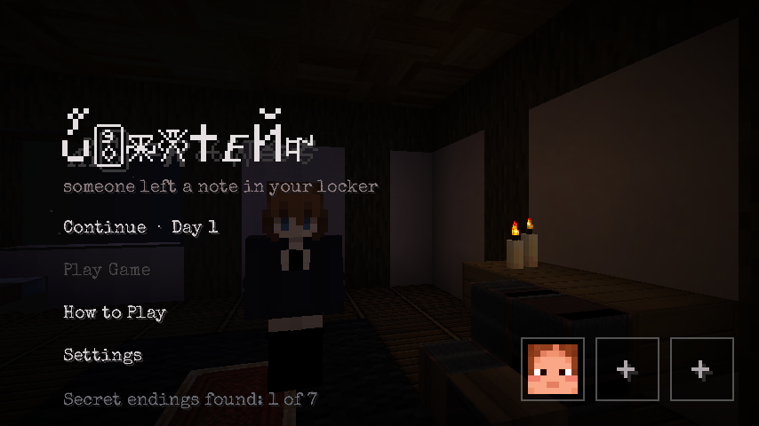
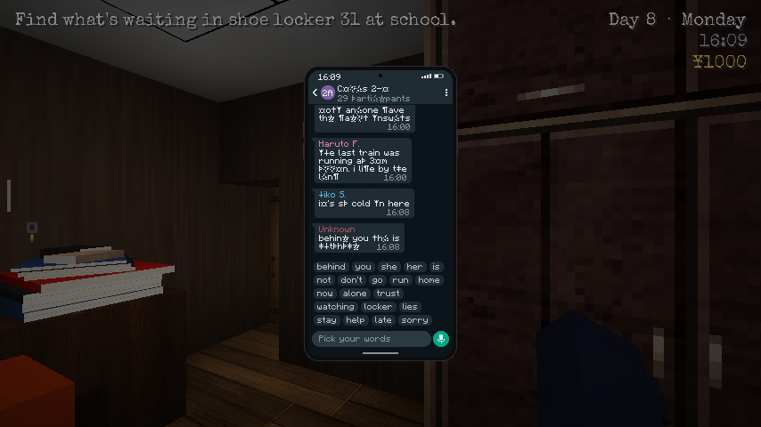
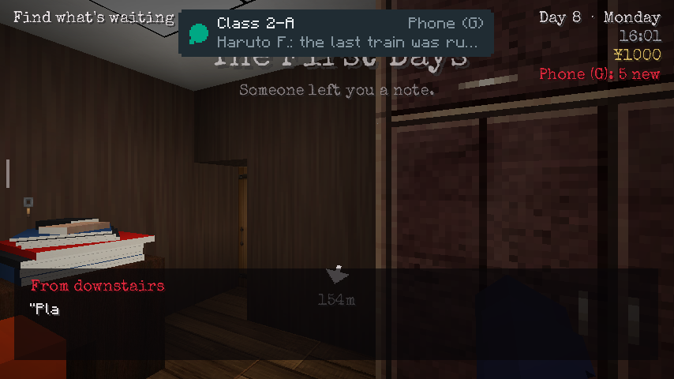
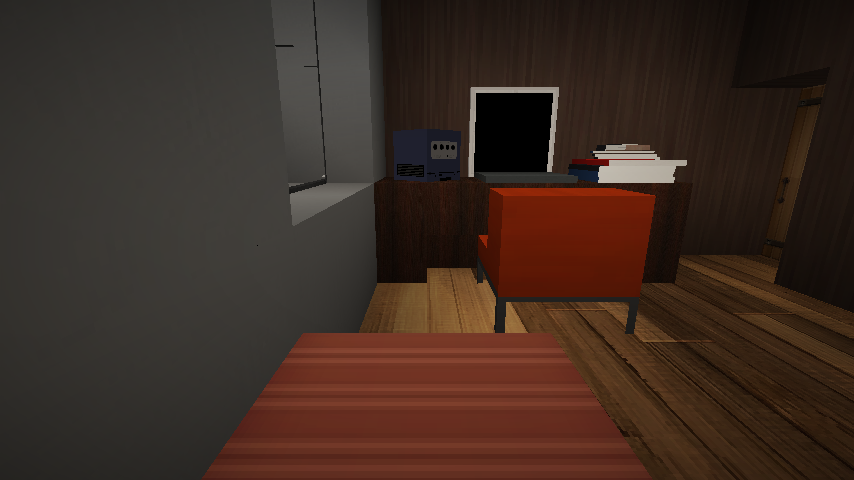

# Kokuhaku

Someone left a note in your locker. You have two weeks to find out which girl is the yandere, before she decides you're hers.

A horror and mystery game built on Minecraft 1.20.1 (Fabric). Play alone or with friends.

| | |
|---|---|
|  |  |
| *The phone. The dead can still post, a few words at a time.* | *Messages drop in at the top of the screen.* |
|  | |
| *Your room. Lock the door at night.* | |

## Playing

1. Install [Prism Launcher](https://prismlauncher.org) and sign in with your Minecraft account.
2. Download the launcher for your computer from the [latest release](https://github.com/jackieboyjt/kokuhaku/releases/latest):
   - **Windows:** the `.exe`
   - **Mac:** `Kokuhaku-Mac.tar.gz`. Double-click it to unpack, then right-click the app and choose **Open**. On macOS 15, go to System Settings → Privacy & Security and click **Open Anyway**.
3. Open it and press **Launch**. The first launch downloads everything it needs, including the map.

## What's new

See [CHANGELOG.md](CHANGELOG.md).

## Building

Fabric mod with Gradle and Java 21: `gradlew build`. The radio songs and the test-only mods in `libs/dev` aren't in this repository.
